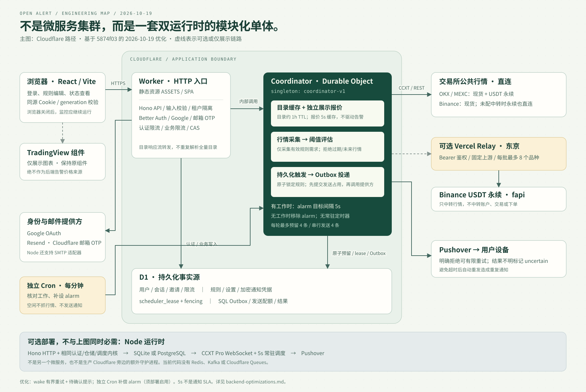
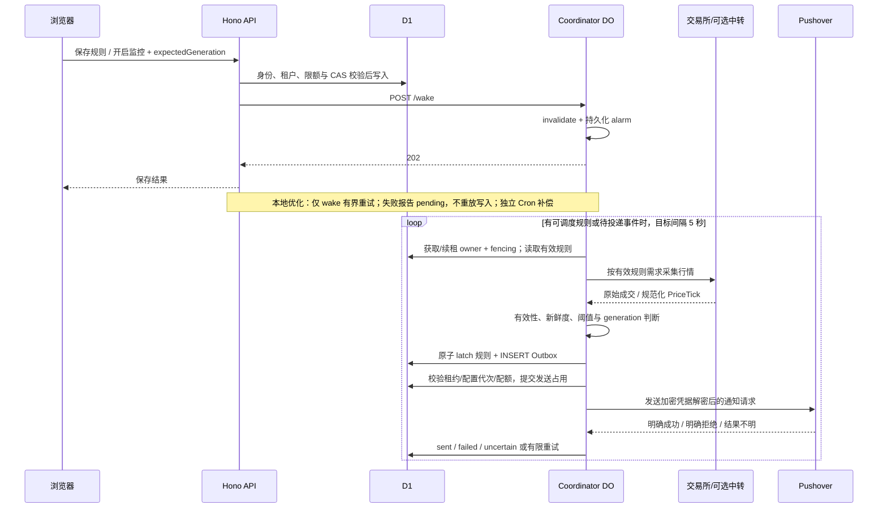

# Open Alert 后端架构（当前实现）

核查日期：2026-10-18 至 2026-10-19。代码基线：`5874f03` + 2026-10-19 本地优化。图中包含本轮补偿与批次优化；代码发布必须同步核对 Cron 触发器，实际版本以部署记录为准；详见 [优化记录](backend-optimizations.md)。

## 1. 一句话定位

**采用端口/适配器拆分的模块化单体，支持 Cloudflare 与 Node 两种替代运行时。** 不是微服务集群。业务规则、SQL 仓储、通知服务和认证策略共用，HTTP、数据库、行情连接和调度驱动按运行平台替换。

| 层 | Cloudflare 路径 | Node 路径 |
| --- | --- | --- |
| Web 与 API | Worker ASSETS + Hono | Node HTTP + Hono + 静态资源 |
| 认证 | Better Auth + Drizzle + D1 | Better Auth + Drizzle + SQLite/PostgreSQL |
| 邮件 | Resend | SMTP / Resend；console 仅开发测试 |
| 调度驱动 | 单例 Durable Object 的持久化 alarm + 每分钟独立 Cron 补偿检查 | 进程内 5 秒 interval |
| 行情 | CCXT 公共 REST；Binance 永续可选 Vercel relay | CCXT Pro WebSocket |
| 持久化 | D1；DO Storage 主要保存 alarm | SQLite 或 PostgreSQL |
| 通知 | SQL Outbox → Pushover | 同一套 SQL Outbox → Pushover |

源代码：`src/runtime/cloudflare.ts`、`src/runtime/node.ts`、`src/runtime/node-services.ts`。TradingView 保留为浏览器图表，不参与后端触发判断，也没有被此次检查修改。

## 2. 告警怎样从规则变成通知

- 行情采用 Binance、OKX、MEXC 的受支持现货和 USDT 永续市场；不是从 TradingView 抓价格。
- `upper` 使用 `price >= threshold`；`lower` 使用 `price <= threshold`，等于阈值也触发。
- 规则触发后锁定，必须显式 rearm；不是价格一直在阈值外就不断发送。
- 超过 30 秒的行情、超过允许未来偏差的行情、无效/不受支持市场不参与触发。
- SQL 提交发送占用在网络发送之前。不能把外部 HTTP 与数据库放进同一个原子事务，因此不宣称“端到端恰好一次”。超时等模糊结果记为 `uncertain`，不自动重发。
- 明确可重试的提供方拒绝才有限退避重试；默认最多 3 次、待处理最长 10 分钟。

核心代码：`src/scheduler/index.ts`、`src/db/repositories.ts`、`src/notifications/service.ts`、`src/notifications/http.ts`。

## 3. 展示与监控必须区分

| 路径 | 用途 | 是否改变监控状态 |
| --- | --- | --- |
| `/api/markets` | 市场元数据；浏览器页面会话缓存、可手动刷新 | 否 |
| `/api/quote` | 独立展示报价；一次协调器调用，5 秒缓存、同品种请求去重 | 否，不创建告警需求 |
| `/api/status?include=alerts` | 健康、监控价格、用户设置与警报；合并轮询 | 不评估价格；DO 会核对工作并修复缺失 alarm |
| TradingView iframe | 交互图表、参考行情 | 否 |
| DO `tick()` / `drain()` | 真正的阈值评估、预留事件与通知发送 | 是 |

全量目录由 DO 准备响应，边缘 Worker 直接转发 body stream，避免重新解码和编码几千个市场。后台目录约 1 小时 TTL；静态元数据与频繁变化的价格/规则分开处理。

Vercel relay 不是第二套告警系统：它只在配置启用时，把 Binance USDT 永续公共行情的固定请求中转到 `fapi.binance.com`。有 Bearer 鉴权、固定上游和最多 8 个品种/批的限制；不接触用户交易账户，不下单。

## 4. 数据与一致性

| 数据组 | 作用 |
| --- | --- |
| Better Auth 表、邀请、注册策略、`rate_limit` | Cookie 会话、身份绑定、准入与节流 |
| 用户设置、渠道、规则 | 租户数据、监控开关、通知选项、规则代次与触发锁定 |
| `scheduler_lease` | owner/fence/expiry；拒绝旧协调器的延迟写入 |
| SQL Outbox | queued → sending → sent/failed/uncertain/cancelled 的持久化发送状态 |
| 发送用量与独立测试通知记录 | 先占每日配额，再发送；测试请求也有持久化约束 |

通知密钥采用绑定用户与字段的 AES-256-GCM 加密。修改规则、设置与渠道使用 generation/CAS；跨租户读写在仓储边界再次校验。当前没有独立的 Redis、Kafka 或 Cloudflare Queues。

## 5. 容量边界，不要误当成 SaaS SLA

仓库 Cloudflare 模板配置为 5 用户、每用户 20 条规则、全局 100 条启用规则、全局 8 个品种；这不是本次重新读取线上绑定后的承诺。

- 单个 `coordinator-v1` 统一调度，资源消耗与一致性容易控制，但不是水平分片架构。
- Cloudflare 默认每轮最多评估 100 条规则、预留 4 条事件、串行发送 4 条通知，且还有时间预算。多规则同时触发会跨轮处理，不能承诺每条都在 5 秒内通知。
- 5 秒是目标调度间隔，不是精确定时保证。网络、平台调度、长请求和重试都会拉长延迟。
- 无工作时删除 alarm，节约资源；本地新增每分钟独立 Cron 补偿首次 wake 失败，上线时必须确认触发器已启用。小批次不突破时间、租约与每日配额，投递结果不明时停止本批，不自动重发。
- 健康检查允许 `degraded` 返回 HTTP 200；应检查 JSON 的 `data.state`，不能仅凭 HTTP 200 宣称所有组件健康。

Cloudflare 的 alarm 至少一次执行与自动重试，以**已成功设置的 alarm**为前提，不能弥补首次设置前丢失的唤醒。参考：[Cloudflare Alarms 官方文档](https://developers.cloudflare.com/durable-objects/api/alarms/)。

## 6. 建议的最小演进顺序

1. **本地已实现**：有界幂等 wake 重试、待确认响应与独立 Cron 补偿；先验证部署与实际恢复，不急于拆微服务。
2. **本地已实现**：覆盖实际认证路径，普通请求不继承 OTP 记录的一小时保留窗口；更长期可拆分限流存储。
3. **本地已实现**：登录能力查询失败返回可重试的 503，不再伪装成管理员未配置。
4. **本地已实现**：统一租约策略来源、合并状态/警报读取与批量摘要，补充故障注入与查询数量验证。
5. 只有用户量、品种量、触发吞吐真实超过当前边界时，再考虑按市场分片 DO 或独立行情/发送工作者。

完整问题、复现与验证范围见 [后端检查报告](backend-audit.md)。
